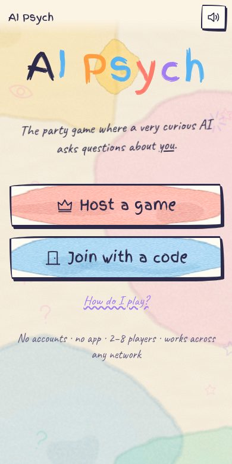
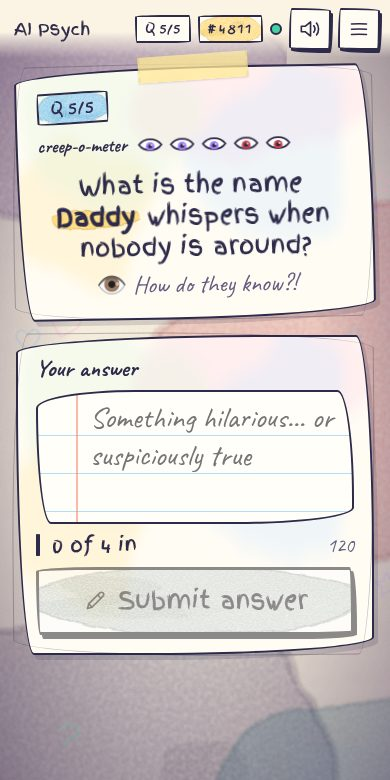
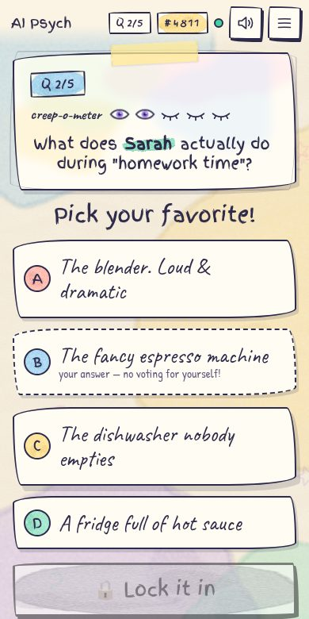
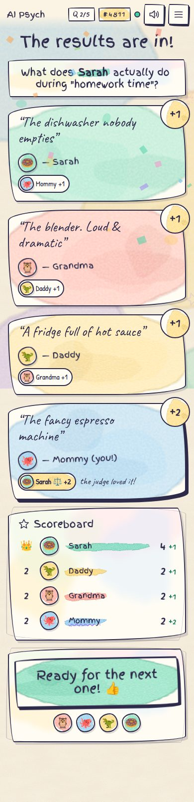
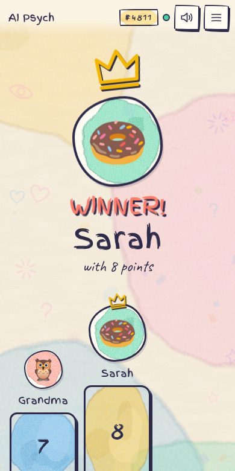
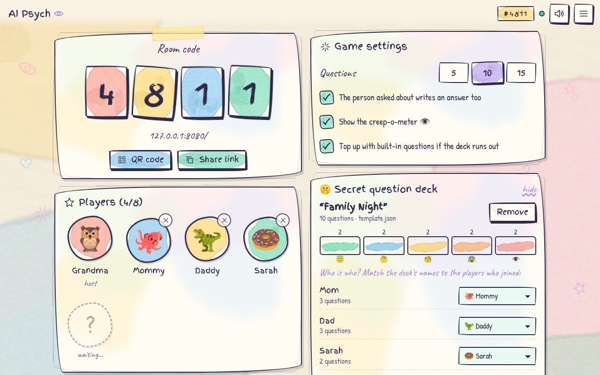

# AI Psych 👁️

**The party game where a very curious AI asks questions about _you_.**

A hand-drawn, watercolor party game in the spirit of _Psych! Outwit Your Friends_. One person hosts, everyone else joins from their own phone with a 4‑digit code, and the "AI" asks questions about the players… questions that get a little too specific as the game goes on.

(The secret: the host uploaded the questions beforehand. 🤫 Nobody else needs to know.)

- 🎨 Hand-drawn watercolor look, lots of animation, synthesized sound effects (every device can mute itself)
- 📱 No accounts, no install, no server to run — a static site that works on GitHub Pages
- 🔌 Peer-to-peer over WebRTC, works across different networks (Wi‑Fi, mobile data…)
- 🔁 Survives refreshes, dropped connections and phones going to sleep — **even the host can refresh**
- 👥 2–8 players, games of 5, 10 or 15 questions

| | | |
| :---: | :---: | :---: |
|  |  |  |
| Home | The creep-o-meter at level 5 | Voting (no voting for yourself!) |
|  |  | |
| Results & scoreboard | The winner | |



---

## How to play

1. **Host**: open the site, tap **Host a game**, pick a name and a face. A 4‑digit room code appears.
2. **Everyone else**: open the same site, tap **Join with a code**, type the code (or scan the QR / use the share link), pick a name and a face.
3. The host picks **5, 10 or 15 questions** and presses **Start**.
4. Each round:
   - 🤖 The AI "writes" a question about one (or two) of the players.
   - ✍️ **Everyone writes an answer.** The screen shows how many answered; after you submit you see who is done and who is still writing.
   - 🗳️ **Vote** for your favorite answer. The answers are dealt to each phone one by one, in a different random order for each player. You can't vote for your own.
   - ⚖️ The person the question is **about** is the judge: **their vote is worth 2 points**. Everyone else's vote is worth **1 point**.
   - 🏆 Results are revealed one by one, then the scoreboard. When everyone taps **Ready**, the next question starts.
5. After the last question there's a drumroll, a podium, confetti, a winner and a few silly awards.
6. **Play again** keeps the same room and players, and **never repeats a question** in that room.

### Host powers

- ⏱ **45-second timer**: puts a countdown on everyone's screen. When it runs out, nothing happens automatically. The host sees who's missing and decides: **move on without them**, **give 45 more seconds**, or keep waiting.
- ⏭ **Skip question**: throws away the current answers and the AI writes a brand-new question for the same round.
- **Next anyway** on the results screen if someone wandered off, **kick** a player from the lobby, **End game** to go back to the lobby.

### Settings (lobby)

- Number of questions: 5 / 10 / 15
- "The person asked about writes an answer too" (on by default)
- Show the creep-o-meter 👁️ (on by default)
- Top up with built-in questions if the deck runs out

---

## The secret question deck

After at least one player has joined, the host can upload a **question deck** in the lobby, and the room code stays on screen while they do it. The deck contains:

- **Questions**, each with a **creepiness level from 1 to 5**
- **Predicted players**: the people you expect to show up (e.g. "Mom", "Dad")

After uploading, the host **matches each predicted player to someone who actually joined** (AI Psych pre-matches obvious ones, like "Mommy" → Mom). The questions then use **the name the player typed when joining**, not the name in the file. If a predicted player didn't join, leave them on "not here" and **every question about them is skipped**.

During a game, questions are picked at random but the creepiness **climbs slowly from the lowest level to the highest**. The game also spreads questions across players so nobody gets asked about every round. Questions are never reused in the same room, even across games.

Without a deck, the AI uses its ~75 built-in questions (with random players).

### Placeholders

| In the file | Becomes |
| --- | --- |
| `{Mom}` | the player the host matched to "Mom" |
| `{any}` (or `{any1}`) | a random player, preferring whoever was asked about least |
| `{any2}`, `{any3}` | more random players, all different from each other and from the named ones |

A question can mention **two players** (e.g. `What does {Sarah} really think of {Mom}'s cooking?`). **Everyone mentioned is "about" the question, so each of their votes counts double.**

### Format 1: JSON (recommended)

```json
{
  "title": "Family Night",
  "players": ["Mom", "Dad", "Sarah", "Grandpa Joe"],
  "questions": [
    { "level": 1, "text": "What is {Mom}'s secret talent that nobody knows about?" },
    { "level": 2, "text": "What would {Grandpa Joe} and {Dad} argue about on a road trip?" },
    { "level": 3, "text": "What did {any} really do last weekend?" },
    { "level": 4, "text": "What does {Sarah} really think of {Mom}'s cooking?" },
    { "level": 5, "text": "What is the name {any} whispers when nobody is around?" }
  ]
}
```

`players` is optional (it's inferred from the placeholders), but listing them catches typos. Grouping by level also works: `"levels": { "1": ["…", "…"], "2": ["…"] }`.

### Format 2: plain text

```text
Title: Family Night
Players: Mom, Dad, Sarah, Grandpa Joe

[Level 1]
What is {Mom}'s secret talent that nobody knows about?

[Level 5]
What is the name {any} whispers when nobody is around?
```

Lines starting with `#` are comments. You can also prefix a single line with its level: `3| Why is {Dad} smiling?`

### Format 3: CSV (from a spreadsheet)

```csv
level,question
1,"What is {Mom}'s secret talent?"
4,"Why was {Dad} awake at 3am last Tuesday?"
```

Templates for all three formats are in [`decks/`](decks/), and the lobby has a **download template** link.

**Creepiness levels:** 1 😇 Innocent · 2 🤔 Curious · 3 🧐 Suspicious · 4 😰 Creepy · 5 👁️ How do they know?!

**Tips for writing a deck:** for a 10-question game with 5 levels, the game uses about 2 questions per level. Write at least 2–3 per level *for each person* so there are options if someone doesn't show up and for a second game. Levels 4–5 are where the "how does it know that?!" moments live.

---

## Deploy to GitHub Pages

This is a plain static site, with no build step and all libraries and fonts included in the repo.

**Option A: GitHub Actions (included)**
1. Push this repository to GitHub (the workflow deploys from `main`).
2. In the repo: **Settings → Pages → Build and deployment → Source: GitHub Actions**.
3. Push to `main` (or run the "Deploy to GitHub Pages" workflow manually). Your game is at `https://<you>.github.io/<repo>/`.

**Option B: deploy from a branch**
**Settings → Pages → Source: Deploy from a branch → `main` / `(root)`**. That's it.

Any static host works too (Netlify, Cloudflare Pages, `python3 -m http.server`…).

---

## How the networking works (and why it's reliable)

- **WebRTC, host-authoritative.** The host's browser runs the game and is the single source of truth. Every player has a direct peer-to-peer data channel to the host.
- **Finding each other.** WebRTC needs a tiny "introduction" (signaling) server. By default AI Psych uses the free public [PeerJS](https://peerjs.com) server. The room code maps to a well-known peer id. After the introduction, game traffic goes device-to-device.
- **Different networks.** Google and Cloudflare STUN servers plus the PeerJS TURN relay are configured, so it works across home Wi‑Fi, mobile data, etc. For strict corporate/school networks you can add your own TURN server in [`js/config.js`](js/config.js).
- **Everything is saved in the browser.** The host saves the whole game to `localStorage` after every change. Players keep their identity (a random id + secret) and any unsent actions. Nothing needs an account.
- **Refresh-proof.** A refreshed player silently rejoins as themselves, and a half-typed answer is kept. A refreshed host reclaims the same room id instantly (it keeps a private token) and everyone reconnects automatically, usually within a second. A service worker caches the app so a refresh works even while the internet is flaky.
- **Self-healing.** Both sides send heartbeats every 2 s. A silent connection (phone asleep, Wi‑Fi hiccup, tunnel) is detected in ~9 s and replaced with a fresh one, retrying with backoff forever. Actions (answers, votes, "ready") are queued and retried until the host acknowledges them, and the host de-duplicates them. So an answer submitted while offline is delivered when the connection comes back.
- **Closed the tab?** Open the site again and tap **Rejoin** (or **Resume** for the host).

### Self-hosting the signaling server (optional)

If you'd rather not depend on the public PeerJS server:

```bash
npx peer --port 9000        # https://github.com/peers/peerjs-server
```

Then either set `SIGNALING` in [`js/config.js`](js/config.js), or open the app with `?signal=https://your.server:443/` (the share link and QR code carry the setting to other players).

---

## Development

```bash
npm start                  # serves the site at http://localhost:8080
npm test                   # engine + deck-parsing unit tests (no dependencies)
npm install                # once, for the end-to-end tests
npx playwright install chromium
npm run test:e2e           # real browsers + real WebRTC + a private signaling server
```

The end-to-end tests play full games with several independent browsers. They also simulate the nasty stuff: player and host refreshes, network black-holes, abrupt ICE failures, a signaling-server restart, a closed tab, timers, skips, kicks and late joiners.

Handy console tools while testing: `__aipsych.current.net.simulateOutage(10000)` silently drops all traffic from that device for 10 s.

### Project layout

```
index.html, css/style.css      page + hand-drawn watercolor styles
js/game/engine.js              the rules: rooms, rounds, scoring, per-player views (pure, unit-tested)
js/game/deck.js                deck parsing (JSON/TXT/CSV), placeholders, creepiness levels
js/game/starter.js             built-in questions
js/net/host-net.js             host side of WebRTC (PeerJS), heartbeats, presence
js/net/client-net.js           player side, reconnect loop with backoff + watchdog
js/host-controller.js          engine ⇄ network glue for the host, persistence
js/player-controller.js        player identity, action queue with retries
js/ui/*                        Preact + htm components, watercolor art, synthesized audio
sw.js                          offline cache
```

## Credits

Built with [Preact](https://preactjs.com) + [htm](https://github.com/developit/htm), [PeerJS](https://peerjs.com), and [qrcode-generator](https://github.com/kazuhikoarase/qrcode-generator) (all bundled in `js/vendor/`). Fonts: [Finger Paint](https://fonts.google.com/specimen/Finger+Paint), [Patrick Hand](https://fonts.google.com/specimen/Patrick+Hand) and [Caveat](https://fonts.google.com/specimen/Caveat) (SIL Open Font License). See [THIRD_PARTY_NOTICES.md](THIRD_PARTY_NOTICES.md).

*AI Psych is a fan-made party game and is not affiliated with Psych! or its makers. (Also, there's no actual AI. Shh.)*
